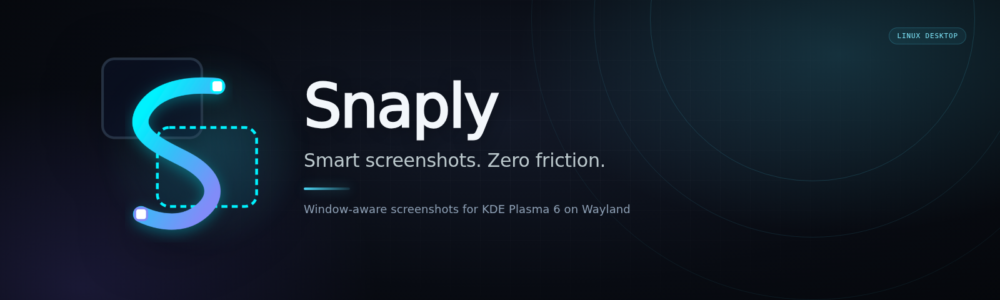
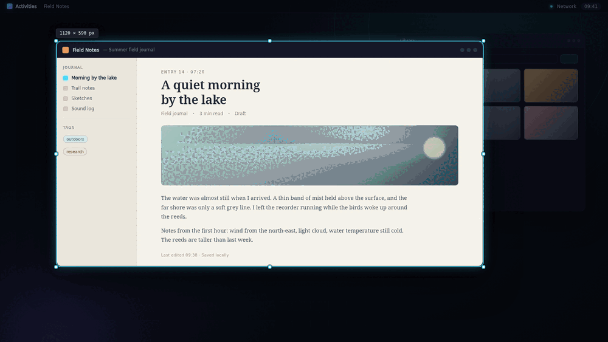
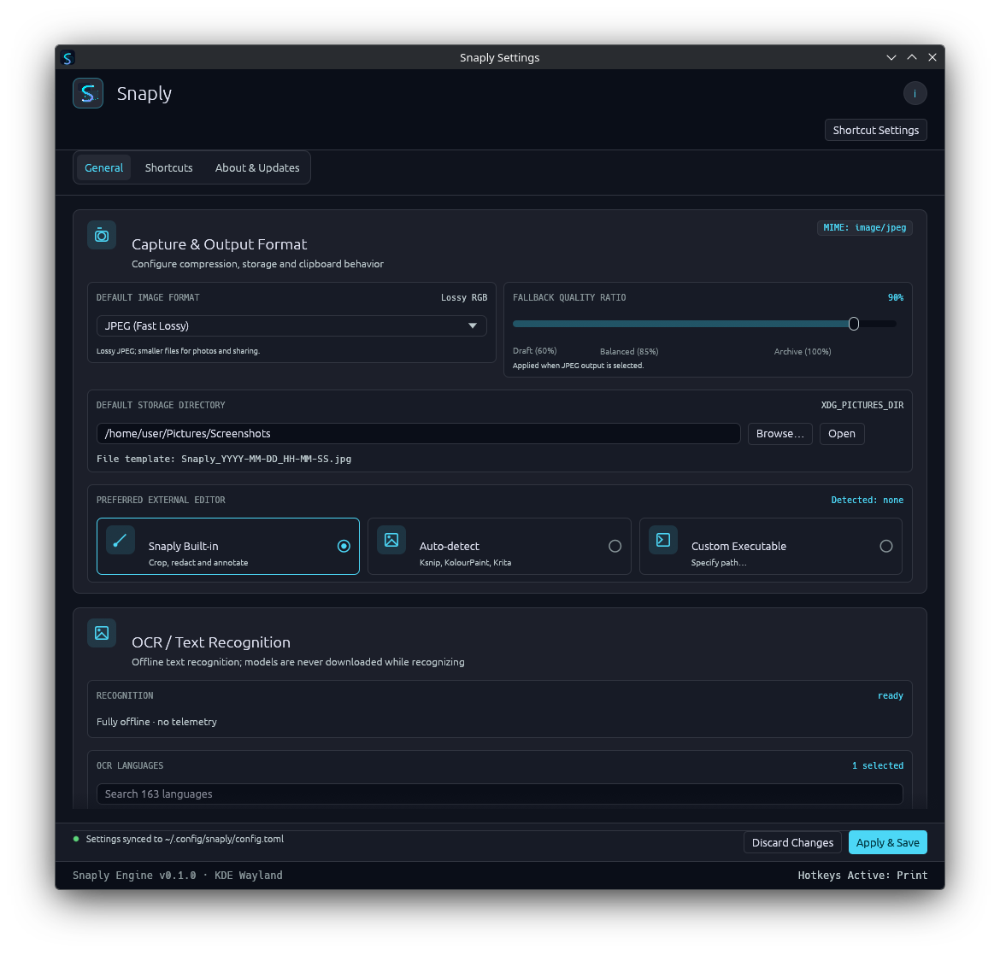
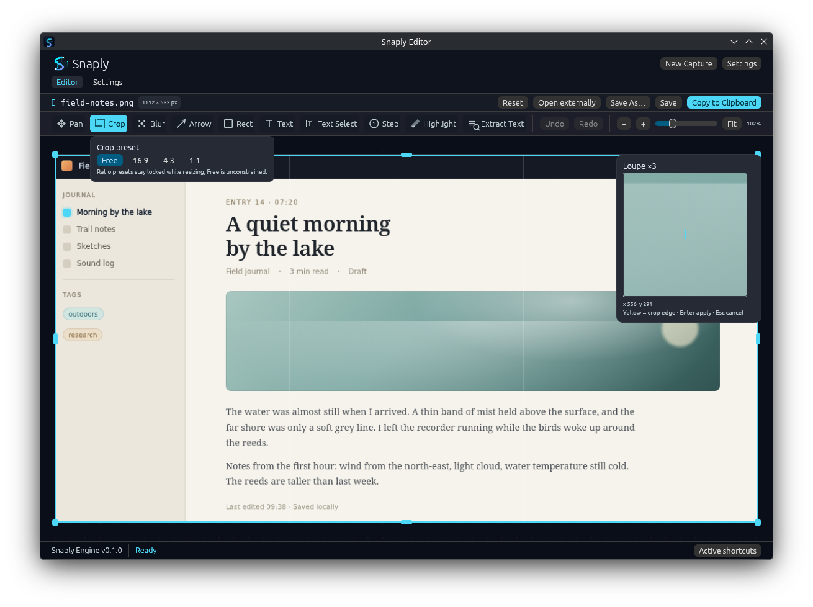

<p align="center">
  
</p>

<p align="center">
  
  
  
</p>

<p align="center">
  <a href="https://github.com/12ozCode/snaply-releases/releases/latest">Download the latest release</a> ·
  <a href="https://github.com/12ozCode/snaply-releases/releases">All releases</a>
</p>

---

## Hover. Click. Done.

<p align="center">
  
</p>

<p align="center">
  <sub>Click a window to select it, then copy the image, OCR the text, edit, or save.</sub>
</p>

Snaply freezes the desktop, finds the window or panel under the pointer, and
outlines it. Click to select it, drag for a region, then copy, edit in the
built-in lightweight editor, or save.

## Features

- **Window-aware selection** — KWin window geometry and stacking order, decorations included. The captured region is clipped to the portion visible above KDE panels, so a window that extends under the taskbar never captures taskbar pixels.
- **Smooth hover** — retargetable ease-out border animation; clicks capture the real target, not an intermediate frame.
- **Regions** — drag to select, then move or resize with handles.
- **KDE panels** — select bottom, top and side Plasma panels/taskbars as one rectangle.
- **Built-in editor** — crop with aspect presets, live Gaussian/pixelate/blackout redaction with per-region settings, arrow (color/thickness), rectangle (color/thickness), text (color/size), step badges (color/size), highlighter (color/opacity), per-tool settings panels, click-to-select and drag/resize placed elements (arrows are edited by dragging either endpoint), live text entry without Add/Cancel, Ctrl+wheel zoom, Shift+wheel horizontal pan, wheel vertical pan, undo/redo, zoom and reset. Active by default.
- **Optional external editor** — keep the built-in editor or switch to an installed image app/custom command in Settings.
- **Fast actions** — Copy, Save, Save As, or open the built-in/external editor. Clicking an empty desktop captures the whole monitor.
- **Formats** — PNG, JPEG (quality 1–100) and lossless WebP. Copy always uses PNG for clipboard compatibility.
- **Automation** — optionally copy immediately after selection, include the mouse cursor, and play a shutter sound.
- **Tray** — a single lightweight StatusNotifierItem with Take Screenshot, Settings, Updates, About and Quit.
- **Global shortcut** — record a key in Settings; it is applied through KGlobalAccel and triggers capture from the tray.
- **Offline OCR** — recognize text locally with the built-in engine; no uploads, no telemetry.

<p align="center">
  
</p>

<p align="center">
  
</p>

## Installation

Download the AppImage or portable tarball and `SHA256SUMS` from the
[latest release](https://github.com/12ozCode/snaply-releases/releases/latest).
Do not use third-party builds.

### AppImage (recommended)

```bash
# Use the filenames shown on the release page.
sha256sum -c SHA256SUMS
chmod +x Snaply-vX.Y.Z-x86_64.AppImage
./Snaply-vX.Y.Z-x86_64.AppImage
```

The AppImage contains the executable, desktop entry, icon, AppStream metadata,
the offline OCR engine and third-party notices. It expects the normal KDE
Plasma 6 / Wayland runtime libraries to be present.

If KWin's screenshot permission check rejects the AppImage, use the portable
install so the hidden KWin permission entry can be installed for the executable.

### Portable tar.gz

```bash
sha256sum -c SHA256SUMS
tar -xzf snaply-vX.Y.Z-linux-x86_64.tar.gz
cd snaply-vX.Y.Z-linux-x86_64
./install.sh
```

`SHA256SUMS` is checked before extracting. The portable installer writes to
`~/.local` and installs the icon, desktop launcher and KWin permission entry.
No root, rpm-ostree layering or system service is required.

## Usage

```bash
snaply              # take a screenshot immediately
snaply --settings   # open Settings (and ensure the tray is running)
snaply --tray       # run the background tray directly
```

The desktop launcher opens Settings. Opening Settings starts the tray if it is
not already running, so Snaply remains available in the background. Closing
Settings does **not** quit the tray.

| Input | Action |
| --- | --- |
| Hover | Highlight the topmost window or KDE panel |
| Click | Select the highlighted window/panel |
| Click + drag | Draw a custom region |
| Drag inside a selection | Move it |
| Drag a handle | Resize it |
| Enter / C | Copy the selection as an image |
| X | Copy text from the selection (OCR) |
| S | Save |
| Shift+S | Save As |
| E | Open the built-in editor |
| Ctrl+C / Ctrl+X / Ctrl+S / Ctrl+Shift+S / Ctrl+E | Same actions, for muscle memory |
| Esc / right-click | Cancel |

### Editor shortcuts

| Input | Action |
| --- | --- |
| `Ctrl+C` | Copy the edited image |
| `Ctrl+S` / `Ctrl+Shift+S` | Save / Save As |
| `Ctrl+O` | Open externally |
| `Ctrl+R` | Reset to the original screenshot |
| `Ctrl+A` | Select the whole image |
| `Enter` | Apply the crop selection |
| `Ctrl+Shift+T` | Extract all text from the edited image |
| `Ctrl+wheel` | Zoom the canvas, or resize the selected element |
| `Ctrl+W` | Close the editor |
| `Delete` / `Backspace` | Delete the selected element |
| `Esc` | Exit the current tool to Pan; Esc again closes |
| Right-click / click empty canvas | Return to Pan (also clears a crop selection) |
| `P` `C` `B` `A` `R` `T` `G` `1` `H` | Pan, Crop, Blur, Arrow, Rectangle, Text, Text Selection, Step, Highlight |

Each tool's settings open in a popover under its own toolbar button. Crop
presets (Free, 16:9, 4:3, 1:1) open under the Crop button and lock their ratio
automatically; choosing **Free** clears the current crop frame for a new
freeform selection. `Esc` cancels a crop and stays in crop mode; use another
tool or right-click to leave. Right-click while drawing any region also
cancels that draw so you can start over. A compact ×3 loupe at the top right
shows pixel coordinates and marks the exact crop edges. A floating bar next to
the selection applies with the green check or `Enter`, and cancels with the red
X or `Esc`.

Click an element to select it, drag to move it, or drag its handles to resize;
arrows expose two endpoint handles instead. Click empty canvas to deselect.
`Ctrl+wheel` with an element selected scales that element. Text updates live
while you type — press Esc or click outside to finish and keep it.

Closing Quick Edit without saving asks whether to save first (Save / Save As /
Exit anyway / Cancel). This warning is on by default and can be disabled in
Settings → Integration & Automation.

### Print Screen

Open **Settings → Shortcuts**, choose **Record…**, and press the key. Snaply
registers it through KDE's KGlobalAccel service and the tray receives the
activation. If another application already owns the combination, Snaply
reports the conflict and does not steal it. **Open KDE Shortcut Settings**
opens KDE's own manager for reassignment or removal.

## OCR (text recognition)

Snaply recognizes text locally with its built-in OCR engine. Nothing is uploaded, and no
model is ever downloaded during recognition.

- **Quick Edit → Extract Text** (`Ctrl+Shift+T`) reads the whole edited image.
- **Text Selection** (`G`) reads a rectangle drawn in Quick Edit. The selection
  never modifies the screenshot; redactions are included.
- **Post-capture menu → Copy Text** OCRs the chosen window or region.
- **`snaply --ocr-region`** (and the *Copy Text from Screen* shortcut) opens
  the normal selection overlay, OCRs the chosen region and copies only text.
  It never saves a screenshot, copies an image, or creates history.

Small images and regions are upscaled before recognition (zooming the editor
only changes the view), and full images use automatic layout
analysis. Results appear in an editable panel with Copy All, Select All, Retry
and Close. The language choice lives in **Settings → OCR**; English is the
default and multiple languages can be combined (`eng+ukr`).

### Languages

Ten OCR language models are bundled: English, Ukrainian, Russian, Romanian,
German, French, Spanish, Italian, Polish and Portuguese. Settings → OCR lists
every language in the pinned upstream manifest (163) with a search box. Extra
models download only when you press **Install**, from a pinned upstream commit,
verified by size and git blob SHA-1, and are stored in Snaply's data directory
where they can be removed again. System OCR models in standard locations are
detected and reused.

## Configuration

Settings writes `~/.config/snaply/config.toml`:

```toml
save_dir = "~/Pictures/Screenshots"
editor_mode = "builtin"  # builtin or external
editor   = "auto"        # external mode: auto or a command
format   = "jpeg"       # png, jpeg, webp (default jpeg)
quality  = 90           # JPEG quality
shortcut = "Print"      # applied through KGlobalAccel by the tray
ocr_shortcut = "Meta+Shift+O"  # Copy Text from Screen
ocr_languages = ["eng"]        # any installed language names
confirm_editor_close = true    # ask to save before closing the editor
autostart = false       # launch snaply --tray at login
```

Existing configurations are migrated; old `start_with_system` /
`keep_in_tray` keys are read and collapsed into `autostart`.

- **Save** creates the directory and never overwrites an existing file.
- **Save As** uses KDE's native dialog and the selected format's filter.
- **Edit** writes a private `0600` temporary file. The built-in editor deletes it after loading; an external editor keeps it for as long as it needs it.
- **Autostart** writes `~/.config/autostart/snaply-tray.desktop` with
  `Exec=<snaply> --tray`; disabling it removes the file.

## Compatibility & limitations

- **KDE Plasma 6 / Wayland only.** X11, GNOME, Sway and Hyprland are not
  claimed or tested.
- Window and panel detection relies on KWin scripting. If it is unavailable,
  free-region selection and capture still work, but hover is disabled.
- Selections are **per monitor**. Dragging across outputs is not supported; a
  window spanning monitors is captured on the monitor where it is clicked.
- A window partially hidden behind a KDE panel is captured **only in its visible
  portion**. Snaply does not reconstruct pixels that the frozen screen did not
  contain.
- Global shortcut activation requires the tray process. Snaply registers via
  KGlobalAccel and never writes KDE's shortcut configuration files directly.
  KDE can reassign or remove the binding at any time.
- WebP output is lossless; the quality setting applies to JPEG.
- Update checks need network access. A release without a matching asset naming
  pattern is reported gracefully rather than downloaded silently.
- No benchmarks or performance numbers are claimed here.

---

Release assets only. Snaply's source code is maintained in a private
repository.
